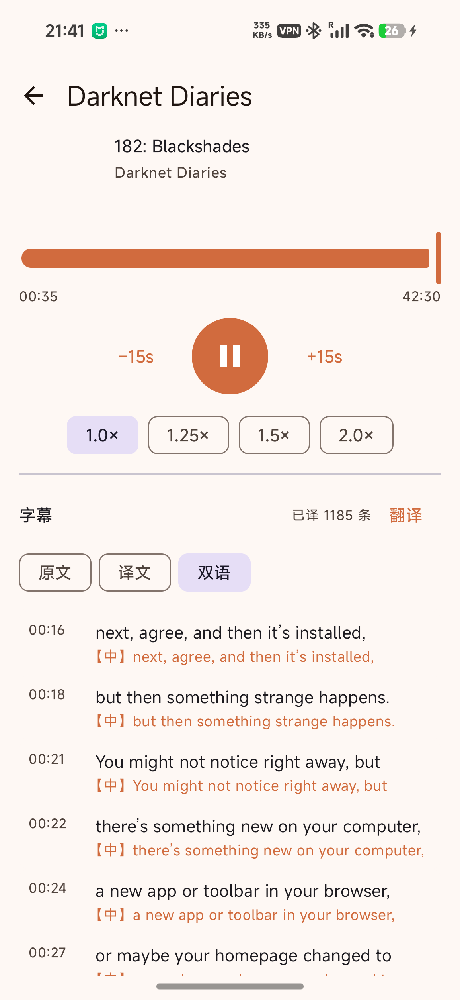
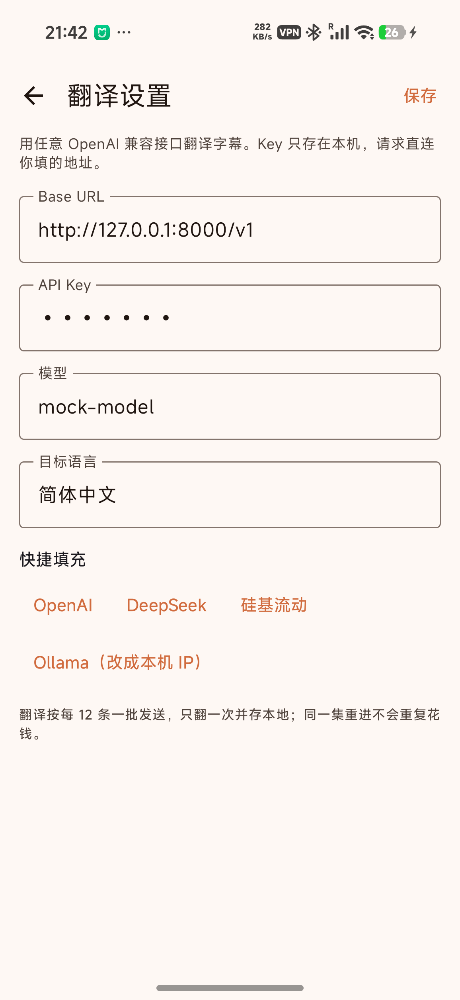
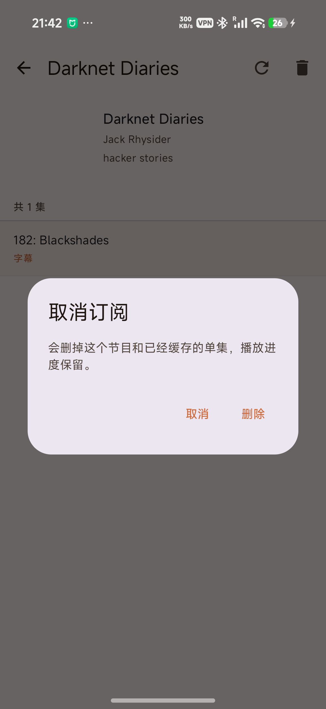
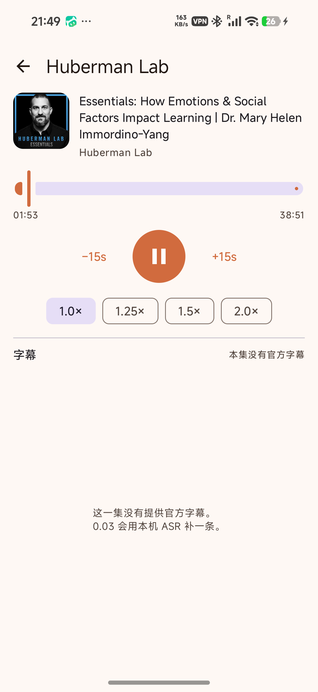
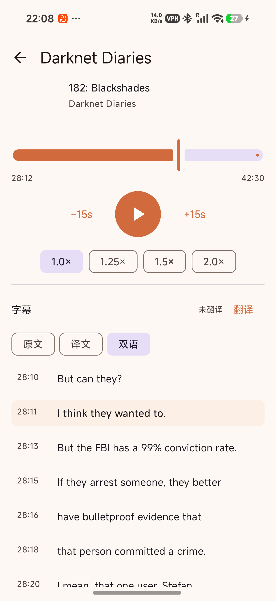

# MoCast 安卓版 · 技术方案

> 目标：把 `joeseesun/subcast`（SubCast · 声渡，Tauri 桌面端）的核心能力落到 Android 上——
> 订阅海外播客 / YouTube → 播放 → 双语字幕 → AI 精读问答。
> 本文档对应 **0.02** 的已落地实现（0.01 的记录保留在文末），并给出 0.03–0.05 的技术路线。

## 1. 0.01 的边界

| 已实现（0.01） | 不做（0.02+） |
|---|---|
| 订阅：RSS 直链、Apple Podcasts、YouTube 频道/播放列表、小宇宙 | YouTube 视频流抓取与播放 |
| 节目详情 + 单集列表（封面、日期、时长、有无字幕） | 双语翻译 |
| 后台播放：Media3 + MediaSessionService，通知栏/锁屏/耳机键 | AI 导读、问答、精读 |
| 倍速 1.0/1.25/1.5/2.0，±15s，断点续播（本地进度） | 本机 ASR（SenseVoice / whisper.cpp） |
| 官方字幕：`podcast:transcript` 的 VTT / SRT / JSON，点句跳转 | 下载离线、海报、统计、OPML、TTS |
| 下拉/刷新单集、错误提示 | 模型服务商管理、代理设置 |

验收口径：粘贴上述任一链接 → 出节目与单集；有音频的集能后台播放并记住进度；带 `podcast:transcript` 的集能显示字幕、点字幕跳到对应时间。

## 2. 完整技术栈

| 层 | 选型 | 版本 | 说明 / 引入版本 |
|---|---|---|---|
| 语言 | Kotlin | 2.0.21 | 协程 + Flow，0.01 |
| 构建 | Gradle (KTS) + AGP | 8.11.1 / 8.7.3 | JDK 17，compileSdk 35，minSdk 26 |
| UI | Jetpack Compose + Material 3 | BOM 2024.10.01 | 单 Activity，状态驱动导航，0.01 |
| 图片 | Coil Compose | 2.7.0 | 封面加载，0.01 |
| 播放 | Media3 ExoPlayer + MediaSessionService | 1.4.1 | 后台播放、通知、锁屏、耳机键，0.01 |
| 网络 | OkHttp | 4.12.0 | 统一 UA、超时、后续接代理，0.01 |
| 解析 | Android XmlPullParser + org.json | 系统内置 | RSS 2.0 / Atom / podcast 命名空间，0.01 |
| 存储 | SharedPreferences + JSON 文件 | 系统内置 | 订阅索引 + 单集缓存 + 进度，0.01；0.02 增翻译缓存目录；0.03 换 Room |
| 数据库（0.03） | Room + FTS4 | 2.6.1 | 单集、字幕、全文搜索；KSP |
| 偏好（0.03） | DataStore Preferences | 1.1.1 | 设置、播放偏好（0.02 仍用 SharedPreferences） |
| 后台任务（0.03） | WorkManager + AlarmManager | 2.9.x | 定时刷新订阅、失败重试 |
| 本机 ASR（0.03） | sherpa-onnx + SenseVoice + Silero VAD | 1.x | arm64、可选 QNN/NNAPI；Whisper.cpp 作备选 |
| 云端 ASR（0.02） | 豆包流式识别 2.0 / 8 家适配 | — | 统一 `AsrEngine` 接口，按集切块上传 |
| 翻译（0.02） | LLM 优先（OpenAI 兼容），谷歌端点兜底 | — | 字幕分段批量翻译，术语表锁定 |
| AI（0.03） | OpenAI 兼容 + Anthropic + Ollama/LM Studio | — | SSE 流式、模型切换、失败降级 |
| YouTube（0.03） | NewPipeExtractor | 0.24.x | GPLv3，与项目 AGPL-3.0 兼容；失败降级纯音频 |
| 分享/海报（0.04） | Compose Canvas + FileProvider | — | 字幕卡片、长图导出 |
| 测试（0.02） | JUnit4 + Robolectric + Compose UI Test | — | 解析器单测优先 |

## 3. 架构

```
Compose UI (Home / ShowDetail / Player)
        │  StateFlow<UiState>
AppViewModel  ──  MediaController  ──►  PlaybackService (MediaSessionService + ExoPlayer)
        │                                      └─ 通知栏 / 锁屏 / 耳机键
        ▼
FeedRepository
   ├─ FeedResolver   链接 → feedUrl（Apple/YouTube/小宇宙/RSS）
   ├─ RssParser      RSS/Atom → Show + Episode[]
   ├─ TranscriptParser VTT/SRT/JSON → Cue[]
   └─ Store          SharedPreferences + files/feeds/*.json
```

设计约束：
- 播放与 UI 解耦：UI 只持有 `MediaController`，进程被杀后播放由前台服务接管。
- 解析器纯函数化（输入字符串、输出模型），便于 0.02 加单测与替换数据源。
- `Store` / `FeedRepository` 接口稳定，0.02 换 Room 时 UI 层不动。

目录（当前）：

```
app/src/main/java/app/mocast/
├── MainActivity.kt / MoCastApp.kt
├── data/    Models.kt  Store.kt  FeedRepository.kt
├── net/     Http.kt  FeedResolver.kt  RssParser.kt  TranscriptParser.kt
├── play/    PlaybackService.kt
└── ui/      AppViewModel.kt  AppRoot.kt  HomeScreen.kt  ShowScreen.kt  PlayerScreen.kt
            Theme.kt  Formatters.kt
```

## 4. 数据模型

```kotlin
Show(id, title, author, artwork, description, feedUrl, source, lastUpdated, episodeCount)
Episode(id, showId, title, description, audioUrl, pageUrl, artwork,
        durationSec, publishedAt, transcriptUrl, transcriptType)
Cue(startMs, endMs, text)
```

- `id`：`MD5(showId|guid或audioUrl)` 取前 8 字节十六进制，保证同一集多次抓取稳定。
- 存储：`shows`（订阅索引）+ `files/feeds/<showId>.json`（单集）+ `progress`（episodeId → ms）。
- 0.02 迁移到 Room：`shows / episodes / cues / progress` 四张表，`episodes` 建 FTS4 供搜索。

## 5. 关键流程

**订阅**（`FeedResolver`）
1. `podcasts.apple.com` → 取 `id` → iTunes lookup → `feedUrl`
2. `youtube.com` → 播放列表 `list=PL…` 直接拼 Atom；`/channel/UC…` 直接拼；`@handle` 抓页面取 `channelId`
3. `xiaoyuzhoufm.com` → 抓页面取 `feed.xyzfm.space/xxx`
4. 其他 http(s) → 当 RSS 直链；非 http 输入直接拒绝

**播放**：`MediaController.setMediaItem(MediaItem(uri, mediaId=episodeId, metadata)) → prepare() → seekTo(进度) → play()`。
进度每 10s、暂停、返回、`onCleared` 时落盘。

**字幕**：`transcriptUrl` 非空 → OkHttp 拉原文 → 按内容嗅探（`{`/`[` 走 JSON，含 `-->` 走 VTT/SRT）→ `Cue[]`。
播放器用 `indexOfLast { startMs <= position }` 定位当前句；点句 `seekTo`。

**翻译（0.02）**：字幕 `Cue[]` 按 12 条一批 → `POST {baseUrl}/chat/completions`（Bearer key，`temperature=0.2`）→ 提示词要求输出**等长 JSON 字符串数组** → 剥 ```json 围栏、按行兜底解析 → 与批内条数对齐（缺失补空串）→ 合并进已完成部分，落盘 `filesDir/translations/<episodeId>_<lang>.json`。
重进播放页先读该文件，命中即显示「已译 N 条」，不会再发请求；换目标语言走另一个语言文件。
未配置 Key 时按钮旁显示「未配置 Key」；HTTP 401/403/404/5xx/网络不通各自映射成中文提示。

**自动下一集（0.02）**：`Player.STATE_ENDED` → 取当前节目列表里本集之后第一个有 `audioUrl` 的集 → `playEpisode()`；已是最后一集则不动作。

**失败兜底**：HTTP 4xx/5xx、DNS 失败、解析为空分别给中文提示；YouTube 视频集显示「0.03 支持」而不是静默失败。

## 6. 0.02 已知限制

- YouTube 仍只订阅列表，不能播放（0.03 接 NewPipeExtractor）。
- 翻译质量依赖所选模型；超长单集（>1000 条）会连续发 ~100 次请求，无并发、无重试节流（0.03 加队列与失败重试）。
- 字幕翻译只对官方字幕生效；没有字幕的集仍不能翻（0.03 本机 ASR 补齐）。
- 无 Room / 无全文搜索、无下载离线、无代理设置、无 AI 精读。
- 订阅删除不清理已下载音频（0.02 尚无声下载），只删节目与字幕缓存。

## 7. 后续版本

| 版本 | 内容 | 对应需求表 |
|---|---|---|
| 0.02 | LLM 双语字幕（原文/译文/双语）+ 翻译服务商设置 + 翻译缓存 + 取消订阅 + 播完自动下一集 | TR-05、SYS-03 |
| 0.03 | Room + FTS4 + YouTube 视频/音频（NewPipeExtractor）+ 下载离线 + 代理 + 本机 ASR（SenseVoice + VAD）+ 无字幕集补齐 | TR-03/04、TR-07、PLAY-05 |
| 0.04 | AI 精读/问答（时间戳）、8 家云 ASR、模型服务商管理、海报、统计、OPML | AI-01/02、TR-06、LLM-01、POST-01 |
| 0.05 | TTS、精读源、共享字幕、自动更新、多语言 | TTS-01、FEED-04、SYS-05、I18N-01 |

## 8. 合规与风险

- 项目衍生自 SubCast（AGPL-3.0），**分发即须开源**；引用其代码需保留版权与许可。
- YouTube 抓流违反其 ToS，Google Play 上架有被拒风险；侧载分发风险自担。
- 谷歌翻译端点非官方 API，随时可能失效，只作兜底。
- 涛声（TaoSheng）为 FSL-1.1-MIT，禁止 Competing Use：只借鉴架构与踩坑，不复用其代码；两年后转 MIT。
- 播客音频版权归各节目所有，App 只做播放器，不做二次分发。

## 9. 构建

```powershell
$env:JAVA_HOME = "D:\Program Files\Android Studio\jbr"
.\gradlew.bat assembleDebug
```

- SDK 路径写在 `local.properties`（`sdk.dir=D:\Android\Sdk`），不入库。
- 产物：`app/build/outputs/apk/debug/app-debug.apk`。
- 包名 `app.mocast`，版本名 `0.01`；正式发布前改成自己的域名反写。

## 10. 0.01 验收记录（2026-11-17）

已验证：

| 项 | 结果 |
|---|---|
| `assembleDebug` | 通过，APK 20.7 MB |
| 模拟器（API 35，x86）安装启动 | 无崩溃，首屏正常 |
| 订阅 NPR Planet Money | 355 集，封面/日期/时长正确 |
| 播放（Planet Money 41 分钟单集） | 位置持续推进，MediaSession 活跃，进度条与倍速正常 |
| 订阅 Darknet Diaries | 183 集，带 `podcast:transcript` 的集显示「字幕」标记 |
| 字幕加载（182 集 VTT） | 1185 条，时间戳正确，可点句跳转 |
| 订阅 YouTube @fireship | 认出 channelId，15 条视频，标题/日期正确 |

未验证 / 已知缺口：

- 真机安装被 MIUI 拦截（`INSTALL_FAILED_USER_RESTRICTED`，需在开发者选项里打开「USB 安装」并允许），因此**锁屏/通知栏后台播放未在真机验收**。
- Apple Podcasts、小宇宙两条解析分支只有代码，没有实测链接。
- 断点续播只验证了同进程返回，未验证杀进程后恢复。
- 没有字幕的集只提示，不会自动补字幕（0.03）。

## 11. 0.02 验收记录（2026-11-17，真机 小米 2510DRK44C / Android 17）

实现：LLM 双语字幕（原文/译文/双语三模式）、翻译服务商设置页、翻译缓存、取消订阅、播完自动下一集、进度条 `valueRange` 修复。

| 项 | 结果 |
|---|---|
| `assembleDebug` | 通过，APK 20.85 MB，versionCode 2 / versionName 0.02 |
| 真机安装（MIUI installer intent） | 覆盖安装成功 |
| 翻译（Darknet Diaries EP182，1185 条字幕） | 约 8 秒完成，按钮显示「已译 1185 条」；服务端日志 99 次请求，符合 12 条/批 |
| 双语渲染 | 每行原文 + 橙色译文，滚动与当前句高亮正常 |
| 翻译缓存 | 退出重进立刻显示「已译 1185 条」，无重复请求 |
| 翻译设置页 | Base URL / Key / 模型 / 目标语言回显正确，快捷填充 OpenAI/DeepSeek/硅基流动/Ollama |
| 取消订阅 | 详情页右上删除 → 确认弹窗 → 取消不删；确认后节目与单集缓存移除，播放进度保留 |
| 播完自动下一集 | Huberman 首集拖到片尾 → 自动切到下一集（Essentials，38:51）并开始播放 |
| 进度条 | 修复前恒满格、点按只跳 0；加 `valueRange` 后位置与拖动 seek 正确 |
| 字幕跟随 | 播放推进时列表自动滚到当前句；手动滑动后暂停跟随 4 秒，右下「回到当前句」可立即归位；拖动进度条跳转后列表同步跳转 |
| 暂停落盘 | `progress` 存成二次转义字符串会抛 `JSONException` 崩主线程；`Store.readProgress` 增加转义修复与空表兜底，暂停/退出不再崩 |

验收方式说明：真机 `adb install` / `pm install` 均 `INSTALL_FAILED_USER_RESTRICTED`，只能 push APK + installer intent 手动确认安装；测试用 mock OpenAI 兼容服务（`adb reverse` 到本机），真实服务商 Key 下的翻译质量与超长集稳定性未验证。






